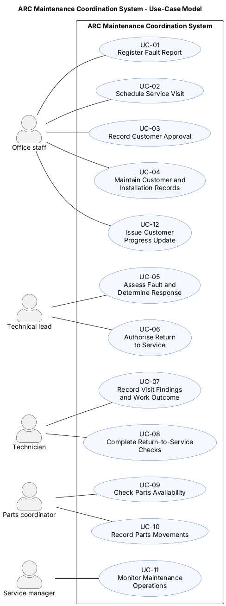

# 6. Use-case model

## 6.1 System boundary and actors

System: **ARC Maintenance Coordination System**

Primary actors: Office staff, Technical lead, Technician, Parts coordinator, Service manager.  
Offstage stakeholders (customer, parts suppliers and manufacturers, site contact) do not interact with the system directly and are therefore not shown on the diagram (see section 4).

## 6.2 Use-case catalogue

**UC-01. Register Fault Report**  
Primary actor: Office staff  
Related: FR-02, S-02

**UC-02. Schedule Service Visit**  
Primary actor: Office staff  
Related: FR-04, S-04

**UC-03. Record Customer Approval**  
Primary actor: Office staff  
Related: FR-07, S-06

**UC-04. Maintain Customer and Installation Records**  
Primary actor: Office staff  
Related: FR-01, S-01

**UC-05. Assess Fault and Determine Response**  
Primary actor: Technical lead  
Related: FR-02, FR-03, S-02, S-03

**UC-06. Authorise Return to Service**  
Primary actor: Technical lead  
Related: FR-10, S-08

**UC-07. Record Visit Findings and Work Outcome**  
Primary actor: Technician  
Related: FR-08, FR-09, S-07

**UC-08. Complete Return-to-Service Checks**  
Primary actor: Technician  
Related: FR-10, S-08

**UC-09. Check Parts Availability**  
Primary actor: Parts coordinator  
Related: FR-05, S-05

**UC-10. Record Parts Movements**  
Primary actor: Parts coordinator  
Related: FR-06, S-05

**UC-11. Monitor Maintenance Operations**  
Primary actor: Service manager  
Related: FR-11, S-09

**UC-12. Issue Customer Progress Update**  
Primary actor: Office staff  
Related: FR-12, S-10

## 6.3 Detailed use case

UC-06. Authorise Return to Service

Primary actor: Technical lead
Scope: ARC Maintenance Coordination System
Related: FR-10, FR-12, NFR-03, BR-02, BR-05, A-02, Q-12, Q-13, P-05

Stakeholders and interests

Technical lead: wants to ensure that equipment returns to service only when it is safe and all required checks are complete.
Technician: wants the checks and work they recorded to be reviewed and their outcome acknowledged.
Office staff: need an up-to-date status to plan follow-up work and inform the customer.
Customer (offstage): needs to know whether the installation is safe to use and what is still outstanding.
Service manager: needs visibility of installations awaiting return-to-service approval.

Preconditions

The technician has completed the required checks and recorded the results (UC-08).
The installation and the work performed are recorded in the system.
The installation is awaiting a return-to-service decision.

Trigger
The technical lead receives a request to approve the return of the installation to service.

Main success scenario

The technical lead selects an installation awaiting return-to-service approval.
The system presents the recorded check results, completed work and any issues found.
The technical lead reviews the results and the required supporting evidence.
The technical lead confirms that the requirements for return to service are met.
The system verifies that the user is authorised to approve return to service and that the required check records are complete.
The system records the decision together with the approving user, date and time.
The system changes the installation status to Approved for return to service.
The system makes the updated status available to office staff for preparing the customer update (UC-12).

Alternative flows

4a. Approval refused: The technical lead records the reason for refusal. The system saves the decision, keeps the installation out of normal service and records the further action required.
4b. Temporary operation only: The technical lead records that only temporary operation is permitted, together with its limitations. The system records the temporary status and does not mark the installation as fully returned to service.

Exceptions

5a. Check records incomplete: The system does not allow the return to service to be approved and identifies which check records are missing. The use case ends without a status change.
5b. User not authorised: The system rejects the approval and does not change the installation status. The use case ends.

Postconditions

Success: The decision is recorded and linked to the installation and its check records; the installation status is updated; the change is captured in the audit trail (NFR-03).
Customer information: A verified update on the outcome and status can be prepared for the customer, excluding internal commercial notes and unverified technical conclusions (FR-12, BR-05).

Open issue: Who counts as an authorised person for each type of work is not yet confirmed. Until then, A-02 applies (Q-12).
