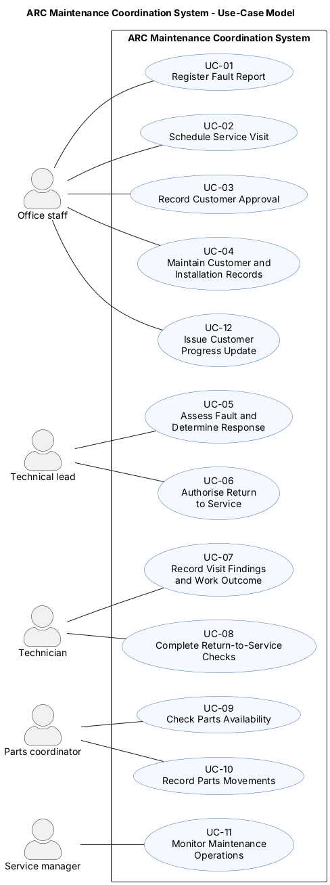
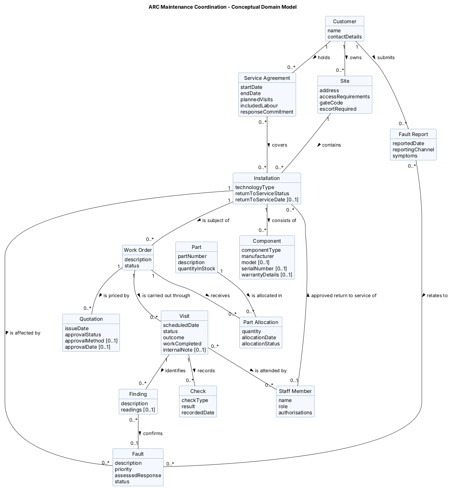

# 1. Introduction

This dossier analyses the requirements and domain of a maintenance coordination system for Atlantic Renewable Care (ARC), based on CA1 Scenario 08. It separates scenario evidence from assumptions and open questions, and traces each requirement from the problems it addresses to the use cases, behavioural examples and domain concepts that realise it. Identifiers are used consistently throughout: facts (F), problems (P), outcomes (O), scope items (S), questions (Q), assumptions (A), risks (R), constraints (C), dependencies (D), stakeholders (SH), business rules (BR), requirements (FR, NFR), use cases (UC), user stories (US) and Gherkin scenarios (RTS).


# 2. Scenario interpretation

## 2.1 Organisation

Atlantic Renewable Care (ARC) is a small maintenance provider for solar photovoltaic (PV), small wind and battery installations across domestic, agricultural and commercial sites (F-01, F-02). Its work covers planned inspections, fault response and approved repairs (F-03). ARC did not install every system it now supports, so it cannot rely on having complete installation records from the outset (F-04, F-07, F-08).

## 2.2 Current process

**Fault intake.** Faults reach ARC by telephone, email or an online enquiry form. Office staff create an initial record and may request readings or photographs (F-13–F-15). A technical lead then decides whether the issue needs remote advice, a routine visit or urgent attendance (F-16).

**Scheduling.** Technicians differ in skills, experience and authorisations, and some visits require several skills, two technicians or specialist access equipment (F-20, F-21). Travel time and weather also affect scheduling (F-22).

**Parts.** Parts may be held in stock, ordered for a specific job or supplied by a manufacturer under warranty (F-23).

**Approval.** Before non-covered work begins, the customer may need to approve a quotation; approval is sometimes given by telephone (F-26, F-27).

**Visit recording.** Technicians record observations, readings, completed work, parts used and photographs, although some readings are entered later from paper notes (F-28, F-30).

**Outcome and return to service.** A visit does not necessarily resolve the fault; outcomes range from no fault found to equipment taken out of service. Before an installation returns to normal service, required checks should be completed and an authorised person should accept the result (F-31–F-33).

**Record storage.** Customer, installation, visit and quotation information is held across separate spreadsheets, email folders and technicians' notebooks (F-05).

## 2.3 Problems and consequences

- **P-01.** Visits are booked without confirming that the technician holds the required authorisation and that the correct parts are available. → The technician arrives on site but cannot carry out the work, so the visit is wasted. (F-20, F-24; service manager quote)
- **P-02.** Customers report symptoms rather than the actual fault, so the required skills and parts may not be known when the visit is planned. → The wrong technician or parts may be sent, resulting in an unproductive visit. (F-14; technician quote)
- **P-03.** Information about completed work reaches the office with a delay, as some records are still on paper. → The office works with out-of-date visit status information. (F-30; office staff quote)
- **P-04.** Customers do not receive clear and timely information about the safety of their system and outstanding work. → Customers may continue to use potentially unsafe equipment. (F-37; customer quote)
- **P-05.** There is no clearly defined process for confirming that equipment is safe to return to service after a repair. → Equipment may be returned to service without all required checks being completed. (F-33, F-34; technical lead quote)
- **P-06.** Parts records are not updated when parts are reallocated between jobs. → Recorded stock levels become inaccurate, which can delay repairs. (F-23; parts coordinator quote)
- **P-07.** Service agreement coverage is unclear and staff rely on emails to decide it, customer approvals are recorded inconsistently, and installation details such as serial numbers, warranties and service history are often incomplete. → Coverage decisions may be wrong, approvals may be disputed, and maintenance decisions rely on unreliable records. (F-07, F-08, F-11, F-27)

The most serious problems are P-04 and P-05, because both can lead to equipment being used when it is not confirmed safe.

## 2.4 Desired outcomes

- **O-01.** Visits are booked only when a suitably authorised technician and the required parts are confirmed. (P-01; service manager)
- **O-02.** The actual fault is confirmed and recorded after inspection and linked to the symptoms originally reported. (P-02; technician, technical lead)
- **O-03.** The office receives timely, up-to-date information when visits are completed. (P-03; office staff)
- **O-04.** Customers receive timely, verified information about the safety of their system and any outstanding work. (P-04; customer)
- **O-05.** Equipment returns to service only after the required checks are completed and an authorised person approves the result. (P-05; technical lead)
- **O-06.** All use and reallocation of parts is recorded promptly, so stock records remain accurate. (P-06; parts coordinator)
- **O-07.** The service manager has a consolidated view of open faults, overdue inspections, technician workload, parts delays, repeat visits, unresolved safety concerns and installations awaiting return-to-service approval, in order to identify outstanding work and coordinate priorities. (F-36; service manager)

## 2.5 Evidence and uncertainty

This analysis is based on CA1 Scenario 08: Renewable Energy Maintenance Service and identifies 41 facts (F-01–F-41). The evidence also includes statements from six stakeholders, which highlight practical problems with technician authorisation, fault identification, visit records, safety decisions and spare parts management. The main uncertainties concern fault prioritisation and service boundaries (Q-01), acceptable evidence of quotation approval (Q-05), authorisation for return to service (Q-12), and access to site information and customer-facing technical details (Q-16, Q-17). To allow the analysis to proceed, eight temporary assumptions (A-01–A-08) have been proposed, for example on how telephone approval is recorded, who authorises return to service and how technicians work without a stable connection. These assumptions are not confirmed company policies and must be validated with the relevant stakeholders. The complete facts, assumptions, questions and risks are provided in Appendix A.

# 3. Purpose, scope and boundary

## 3.1 Purpose

The purpose of the system is to help ARC coordinate maintenance of renewable energy installations by managing fault reports, technician scheduling, spare parts, service visits and return-to-service approvals, so that work is completed efficiently, equipment returns to service only after the required checks, records remain accurate, and customers receive reliable updates on the status and safety of their installations.

## 3.2 In scope

- **S-01.** Recording and managing customers, sites, installations and components, including site access information with restricted visibility (P-07)
- **S-02.** Recording fault reports, assessing faults and tracking their status (P-02, P-04)
- **S-03.** Supporting fault prioritisation and linking related reports, findings and work (P-02)
- **S-04.** Coordinating technician scheduling based on skills, authorisations, availability and site conditions (P-01)
- **S-05.** Managing spare parts availability, allocation and usage records (P-01, P-06)
- **S-06.** Recording service agreement coverage, quotations and customer approvals (P-07)
- **S-07.** Recording maintenance visits, inspection findings, work completed and visit outcomes (P-03)
- **S-08.** Managing required safety checks and return-to-service approval (P-04, P-05)
- **S-09.** Providing a management overview of open faults, overdue inspections, technician workload, parts delays and pending approvals (O-07, F-36)
- **S-10.** Providing controlled progress updates and reports to customers (P-04)

## 3.3 Out of scope

- **Live energy monitoring** – Explicitly excluded in the scenario (F-41).
- **Equipment control** – Explicitly excluded in the scenario (F-41).
- **Customer billing systems** – Explicitly excluded in the scenario (F-41).
- **Emergency electrical response** – ARC does not provide this service; safety concerns are escalated instead (F-17).
- **Installation and commissioning of new systems** – The scenario describes maintenance only; it is not stated whether ARC still installs systems. Treated as out of scope until confirmed (Q-19).

## 3.4 Dependencies, assumptions and constraints

**Dependencies**

- **D-01.** External suppliers and manufacturers: availability and delivery of spare parts, including parts supplied under warranty, depend on external organisations (F-23).
- **D-02.** Technicians' mobile devices: technicians use phones or tablets to access and record maintenance information (F-38).
- **D-03.** Customer cooperation: scheduling and non-covered work depend on site access arrangements and customer approval of quotations (F-12, F-26).
- **D-04.** Stakeholder decisions: the system depends on the service manager and technical lead confirming business rules for fault priorities, technician authorisations and return-to-service approval (Q-01, Q-07, Q-12).

**Assumptions**

The analysis relies on temporary assumptions A-01–A-08, listed in Appendix A, which must be confirmed with stakeholders.

**Constraints**

- **C-01.** Unreliable connectivity: the system must allow for poor internet connectivity at rural and remote sites (F-38).
- **C-02.** Defined project boundaries: live energy monitoring, equipment control and customer billing are excluded (F-41; see 3.3).
- **C-03.** Small company resources: ARC is a small company, so the system should remain practical to implement, operate and maintain (F-01).
- **C-04.** Existing incomplete records: some installations lack model, serial number, warranty or service history information (F-07, F-08), which limits the completeness of historical data.
- **C-05.** Different access requirements: office staff, technicians and managers require different levels of access to operational, technical and site-access information, and customers receive only approved information (F-12, F-35, F-39).


# 4. Stakeholders and actors

## 4.1 Stakeholder catalogue

Influence indicates how strongly a stakeholder's view is expected to shape the system requirements.

| ID | Stakeholder | Type | Goal | Concern | Influence | Evidence |
|---|---|---|---|---|---|---|
| SH-01 | Service manager | Direct | Coordinate maintenance operations and monitor open faults, overdue inspections, technician workload and parts delays. | Visits being scheduled without the correct technician authorisation or required parts; lack of reliable operational information. | High. | Service manager quote; F-36. |
| SH-02 | Technical lead | Direct | Assess reported faults, determine the appropriate response and ensure technical and safety requirements are met. | Incorrect fault assessment, unclear technician authorisations and unsafe return-to-service decisions. | High. | Technical lead quote; F-16–F-19, F-33, F-34. |
| SH-03 | Office staff | Direct | Register fault reports, manage customer communications, coordinate visits and maintain accurate records. | Delayed technician paperwork, inconsistent quotation approvals and outdated visit statuses. | High. | Office staff quote; F-13–F-15, F-27, F-30. |
| SH-04 | Technicians | Direct | Access assigned job information, record inspections and repairs, and update parts usage and visit outcomes. | Missing technical information, unavailable parts, unsuitable site conditions and poor connectivity. | High. | Technician quote; F-20–F-25, F-28–F-32, F-38. |
| SH-05 | Parts coordinator | Direct | Track spare parts, maintain accurate stock records and ensure parts are available for scheduled work. | Parts being used for other jobs without records being updated, leading to inaccurate stock information. | Medium. | Parts coordinator quote; F-23, F-24. |
| SH-06 | Customer | Indirect (provisional) | Receive clear progress updates and understand whether the installation is safe to use and what work remains outstanding. | Unclear safety status, delays, unexpected costs and receiving unverified technical conclusions. | High, because customer safety is the most serious risk identified (P-04). | Customer quote; F-26, F-27, F-35, F-37. The customer is provisionally classified as indirect because the scenario states that customers receive updates but does not confirm that they will use the proposed system directly. |
| SH-07 | Parts suppliers and manufacturers | External | Supply the correct spare parts and fulfil orders or warranty-related parts requests. | Incorrect orders, incomplete job information or delays in confirming parts requirements. | Medium. | F-23. The scenario confirms that parts may be ordered for specific jobs or supplied by manufacturers under warranty. |
| SH-08 | Site contact | External | Coordinate site access and help technicians enter the premises safely and at the agreed time. | Unauthorised access, scheduling conflicts or missing access arrangements. | Medium. | F-12. The scenario identifies site contacts, gate codes and escorts as possible access requirements, but does not confirm that every site has a separate contact person. |
| SH-09 | Company owner / senior management | Indirect (unconfirmed) | Ensure that the maintenance service operates effectively and that investment in the proposed system supports business needs. | Implementation costs, operational disruption and a system that does not improve maintenance coordination. | High (provisional). | F-01 identifies ARC as a small company, but the scenario does not describe ownership or funding arrangements. |
| SH-10 | Parts delivery and logistics providers | External (unconfirmed) | Deliver ordered spare parts to the required location within the agreed timeframe. | Delivery delays, incorrect delivery details or unavailable stock. | Low–Medium. | Inferred from F-23 and F-24. The scenario does not identify a separate delivery provider; this stakeholder is retained only if confirmed as distinct from suppliers. |

## 4.2 Actor classification

An actor is a person or external system that directly interacts with the proposed system to achieve a goal. A stakeholder is not automatically an actor.

| Stakeholder | Classification | Justification |
|-------------|----------------|---------------|
| Service manager | Primary actor | Uses the system to monitor maintenance operations and review performance. |
| Technical lead | Primary actor | Uses the system to assess faults and manage technical and safety decisions. |
| Office staff | Primary actor | Uses the system to register faults, coordinate visits and manage customer communications. |
| Technicians | Primary actor | Use the system to access job details and record inspection and repair outcomes. |
| Parts coordinator | Primary actor | Uses the system to manage spare parts and update stock records. |
| Customer | Offstage stakeholder (provisional) | Receives updates, but direct access to the system is not specified in the scenario. |
| Parts suppliers and manufacturers | Offstage stakeholder | Supply parts, including warranty parts, but direct system interaction is not specified. |
| Site contact | Offstage stakeholder | Supports site access, but direct system interaction is not specified. |
| Company owner / senior management | Offstage stakeholder (unconfirmed) | May influence budget and priorities, but ownership is not described in the scenario. |
| Parts delivery and logistics providers | Offstage stakeholder (unconfirmed) | May affect parts delivery, but a separate provider is not confirmed. |

**Supporting actors:** No supporting actors are confirmed, because the scenario does not describe any external system or party interacting directly with the proposed system. This should be reviewed if supplier access or system integrations are added later.

## 4.3 Actor–goal table

| Actor | Type | Goals |
|-------|------|-------|
| Service manager | Primary | Monitor open faults and overdue inspections; review technician workload and repeat visits; identify parts delays and unresolved safety concerns; monitor installations awaiting return-to-service approval. |
| Technical lead | Primary | Review and assess fault reports; determine the required response; review technical findings and work outcomes; authorise or record return-to-service decisions according to agreed rules (Q-12). |
| Office staff | Primary | Register fault reports; maintain customer, site and installation records; schedule and coordinate maintenance visits; record quotation approvals and communicate progress to customers. |
| Technicians | Primary | Access assigned job and site information; record inspection readings, photographs and work completed; record parts used and visit outcomes. Whether technicians may authorise return to service is unresolved (Q-12). |
| Parts coordinator | Primary | Check spare parts availability; allocate parts to work orders; record stock movements and usage; update records when parts are transferred between jobs. |

## 4.4 Customer access

The scenario states that customers need progress updates and clear information about safety and outstanding work, but it does not say that customers will use the system directly. The customer is therefore treated as an offstage stakeholder, with office staff responsible for communicating approved updates.

If ARC later decides to provide a customer portal, the customer would become a primary actor with goals such as viewing maintenance progress, reading approved service reports, reviewing outstanding work and viewing confirmed safety and return-to-service information.


# 5. Requirements and business rules

## 5.1 Functional requirements

| ID | Requirement | Priority | Source | Rationale | Verification |
|---|---|---|---|---|---|
| FR-01 | The system shall maintain records of customers, sites, installations and components. | Must | S-01, F-01–F-08 | Provides a central record of the installations maintained by ARC. | Test – create and retrieve a customer, site, installation and component record. |
| FR-02 | The system shall record each fault report, including the reported symptoms, the technical lead's assessed response and the current fault status. | Must | S-02, P-02, F-13–F-16, F-31, F-32, BR-04 | Ensures that reported faults are captured, assessed and tracked from reporting to resolution. | Test – submit a fault report, record an assessed response, update its status and verify that all details are saved. |
| FR-03 | The system shall link related fault reports to the same underlying fault. | Should | S-03, P-02, F-18, F-19 | Allows staff to connect related reports, findings and work decisions. | Test – link two reports concerning the same fault and verify that both are associated with the underlying fault. |
| FR-04 | The system shall check that a technician's recorded skills and authorisations meet the requirements of a work order before assignment. | Must | S-04, P-01, F-20, F-21, BR-06, Q-07 | Reduces the risk of assigning work to an unsuitable or unauthorised technician. | Test – attempt to assign a technician without a required authorisation and verify that the assignment is rejected. |
| FR-05 | The system shall record the availability of the spare parts required for each work order. | Must | S-05, P-01, F-23, F-24 | Prevents repair visits being scheduled before required parts are available. | Test – record parts availability for a work order and verify that the work order shows whether all required parts are available. |
| FR-06 | The system shall record the allocation and reallocation of spare parts between work orders and update the corresponding stock records. | Must | S-05, P-06, F-23, F-24; parts coordinator quote | Keeps stock records accurate when parts are moved to urgent jobs. | Test – reallocate a part from one work order to another and verify that both work orders and the stock record are updated. |
| FR-07 | The system shall record quotations and their customer approval status. | Should | S-06, P-07, F-26, F-27, BR-01, Q-05, Q-06 | Helps staff identify whether non-covered work has been approved before it begins. | Test – record a quotation and its approval status, then retrieve the updated record. |
| FR-08 | The system shall record maintenance visit findings, completed work and visit outcomes against the relevant work order. | Must | S-07, P-03, F-25, F-28–F-32; office staff quote | Ensures that maintenance activities and their outcomes are documented. | Test – record inspection findings, completed work and a visit outcome, then verify that the visit record can be retrieved. |
| FR-09 | The system shall maintain the current status of each maintenance visit. | Should | S-07, P-03, F-30 | Allows office staff to see whether a visit is scheduled, in progress or complete. | Test – update a visit from in progress to completed and verify that the current status is shown. |
| FR-10 | The system shall not allow an installation to be marked as returned to service until the required safety checks have been recorded and an authorised person has approved the return to service. | Must | S-08, P-05, F-33, F-34, BR-02, Q-12, Q-13; technical lead quote | Ensures that repair completion is distinguished from authorisation to return equipment to service. | Test – attempt to mark an installation as returned to service without recorded checks or approval and verify that the system refuses; then record both and verify that the change is accepted. |
| FR-11 | The system shall provide the service manager with reports on open faults, overdue inspections, technician workload and parts delays. | Should | S-09, O-07, F-36 | Helps the service manager identify maintenance issues requiring attention. | Test – create sample records containing these conditions and verify that the report reflects their current status. |
| FR-12 | The system shall record progress updates for customers that contain only information approved for external communication. | Should | S-10, P-04, F-35, F-37, BR-05, Q-17 | Keeps customers informed about safety and outstanding work without sharing unverified conclusions or internal notes. | Test – prepare a customer update from a record containing internal notes and verify that only approved information is included. |

## 5.2 Non-functional requirements

| ID | Requirement | Priority | Source | Rationale | Verification |
|---|---|---|---|---|---|
| NFR-01 | Offline operation: The system shall allow technicians to create and update assigned visit records while offline and shall synchronise saved changes within 5 minutes of connectivity being restored. | Must | F-38, S-07, C-01, A-05 | Supports technicians working at rural and remote sites with unreliable connectivity. | Test – update a visit offline, restore connectivity and verify that the changes synchronise within 5 minutes. |
| NFR-02 | Role-based access: The system shall enforce role-based access for 5 user roles: office staff, technicians, parts coordinator, service manager and technical lead, including restricted access to site access details such as gate codes. | Must | F-12, F-35, F-39, S-01, C-05, A-03 | Ensures that users can access only the information appropriate to their responsibilities. | Test – use an account for each of the 5 roles and verify that each role can access permitted information, and that gate codes are visible only to permitted roles. |
| NFR-03 | Audit trail: The system shall record 100% of changes to fault statuses, visit statuses, parts allocations and return-to-service decisions, including the user, timestamp, previous value and new value. | Must | F-19, F-30, F-33, F-39 | Supports accountability and investigation of changes to important maintenance records. | Test – change each specified record type and verify that all required audit details are stored. |
| NFR-04 | Performance: The system shall display the service manager's maintenance overview within 3 seconds for at least 95% of requests with up to 10 concurrent users. | Should | F-36, S-09, C-03 | Allows the service manager to review maintenance operations without excessive waiting. | Performance test – simulate 10 concurrent users and confirm that at least 95% of overview requests complete within 3 seconds. |

Numeric targets in NFR-01 and NFR-04 are provisional and must be confirmed with ARC.

## 5.3 Business rules

| ID | Rule | Status | Source | Enforced by |
|---|---|---|---|---|
| BR-01 | Work not covered by the customer's service agreement must not begin until the customer has approved the quotation. | Provisional – the scenario states that customers "may need" to approve; acceptable evidence of approval is unresolved. | F-26, F-27, Q-05, Q-06 | FR-07 |
| BR-02 | An installation must not be returned to normal service until the required checks have been completed and an authorised person has accepted the result. | Confirmed in principle; who counts as an authorised person is unresolved (Q-12). | F-33, F-34; technical lead quote | FR-10 |
| BR-03 | ARC does not provide emergency electrical response; safety-related concerns must be escalated, and customers may be advised to isolate equipment. | Confirmed; the escalation procedure is not defined (Q-02). | F-17 | Not yet covered – no requirement currently supports recording or escalating safety concerns. |
| BR-04 | The technical lead decides whether a reported fault requires remote advice, a routine visit or urgent attendance. | Confirmed | F-16 | FR-02 |
| BR-05 | Commercial notes and internal safety discussions must not be automatically included in customer-facing reports. | Confirmed | F-35, F-37 | FR-12 |
| BR-06 | A technician may be assigned to work only if they hold the skills and authorisations required for that type of work. | Provisional – the required skills and authorisations for each type of work are not defined (Q-07). | F-20, F-21; service manager quote | FR-04 |


# 6. Use-case model

## 6.1 System boundary and actors

System: **ARC Maintenance Coordination System**

Primary actors: Office staff, Technical lead, Technician, Parts coordinator, Service manager.  
Offstage stakeholders (customer, parts suppliers and manufacturers, site contact) do not interact with the system directly and are therefore not shown on the diagram (see section 4).



## 6.2 Use-case catalogue

**UC-01. Register Fault Report**  
Primary actor: Office staff  
Related: FR-02, S-02

**UC-02. Schedule Service Visit**  
Primary actor: Office staff  
Related: FR-04, S-04

**UC-03. Record Customer Approval**  
Primary actor: Office staff  
Related: FR-07, S-06

**UC-04. Maintain Customer and Installation Records**  
Primary actor: Office staff  
Related: FR-01, S-01

**UC-05. Assess Fault and Determine Response**  
Primary actor: Technical lead  
Related: FR-02, FR-03, S-02, S-03

**UC-06. Authorise Return to Service**  
Primary actor: Technical lead  
Related: FR-10, S-08

**UC-07. Record Visit Findings and Work Outcome**  
Primary actor: Technician  
Related: FR-08, FR-09, S-07

**UC-08. Complete Return-to-Service Checks**  
Primary actor: Technician  
Related: FR-10, S-08

**UC-09. Check Parts Availability**  
Primary actor: Parts coordinator  
Related: FR-05, S-05

**UC-10. Record Parts Movements**  
Primary actor: Parts coordinator  
Related: FR-06, S-05

**UC-11. Monitor Maintenance Operations**  
Primary actor: Service manager  
Related: FR-11, S-09

**UC-12. Issue Customer Progress Update**  
Primary actor: Office staff  
Related: FR-12, S-10

## 6.3 Gherkin examples

The behavioural examples below are stored in `features/return-to-service.feature` and refine UC-06 and FR-10.

```gherkin
# Related: UC-06, FR-10, BR-02, A-02, Q-12
Feature: Authorise return to service
  As a technical lead
  I want to approve return to service only when required checks are complete
  So that equipment is not used before it is confirmed safe

  Background:
    Given installation "INS-204" at site "Ballymore Farm" is awaiting a return-to-service decision
    And technical lead "Aoife Byrne" is authorised to approve return to service for battery work

  Rule: Return to service requires complete checks and an authorised approver (BR-02)

    @RTS-01
    Scenario: Approve return to service when all checks are recorded
      Given all required checks for "INS-204" have been recorded as passed
      When "Aoife Byrne" approves the return to service
      Then the status of "INS-204" is "Approved for return to service"
      And the decision is recorded with "Aoife Byrne" as the approver and the current date and time

    @RTS-02
    Scenario: Refuse approval when a required check is missing
      Given the insulation resistance test for "INS-204" has not been recorded
      When "Aoife Byrne" attempts to approve the return to service
      Then the approval is refused because a required check is missing
      And the status of "INS-204" remains "Awaiting return-to-service approval"
      And the missing insulation resistance test is identified

    @RTS-03
    Scenario: Reject approval by a user without authority
      Given technician "Liam Murphy" is not authorised to approve return to service
      And all required checks for "INS-204" have been recorded as passed
      When "Liam Murphy" attempts to approve the return to service
      Then the approval is rejected because "Liam Murphy" lacks the required authority
      And the status of "INS-204" remains "Awaiting return-to-service approval"

  Rule: Temporary operation is not a full return to service

    @RTS-04
    Scenario: Allow temporary operation only
      Given the replacement battery module for "INS-204" is awaiting delivery
      And all other required checks for "INS-204" have been recorded as passed
      When "Aoife Byrne" authorises temporary operation limited to 50% output until the module is replaced
      Then the status of "INS-204" is "Temporary operation authorised"
      And the limitation "50% output until module replaced" is recorded with the decision
      And "INS-204" is not marked as approved for return to service
```

## 6.4 Detailed use case

### UC-06. Authorise Return to Service

**Primary actor:** Technical lead  
**Scope:** ARC Maintenance Coordination System  
**Related:** FR-10, FR-12, NFR-03, BR-02, BR-05, A-02, Q-12, Q-13, P-05

**Stakeholders and interests**
- Technical lead: wants to ensure that equipment returns to service only when it is safe and all required checks are complete.
- Technician: wants the checks and work they recorded to be reviewed and their outcome acknowledged.
- Office staff: need an up-to-date status to plan follow-up work and inform the customer.
- Customer (offstage): needs to know whether the installation is safe to use and what is still outstanding.
- Service manager: needs visibility of installations awaiting return-to-service approval.

**Preconditions**
1. The technician has completed the required checks and recorded the results (UC-08).
2. The installation and the work performed are recorded in the system.
3. The installation is awaiting a return-to-service decision.

**Trigger**  
The technical lead receives a request to approve the return of the installation to service.

**Main success scenario**
1. The technical lead selects an installation awaiting return-to-service approval.
2. The system presents the recorded check results, completed work and any issues found.
3. The technical lead reviews the results and the required supporting evidence.
4. The technical lead confirms that the requirements for return to service are met.
5. The system verifies that the user is authorised to approve return to service and that the required check records are complete.
6. The system records the decision together with the approving user, date and time.
7. The system changes the installation status to *Approved for return to service*.
8. The system makes the updated status available to office staff for preparing the customer update (UC-12).

**Alternative flows**
- **4a. Approval refused:** The technical lead records the reason for refusal. The system saves the decision, keeps the installation out of normal service and records the further action required.
- **4b. Temporary operation only:** The technical lead records that only temporary operation is permitted, together with its limitations. The system records the temporary status and does not mark the installation as fully returned to service.

**Exceptions**
- **5a. Check records incomplete:** The system does not allow the return to service to be approved and identifies which check records are missing. The use case ends without a status change.
- **5b. User not authorised:** The system rejects the approval and does not change the installation status. The use case ends.

**Postconditions**
- **Success:** The decision is recorded and linked to the installation and its check records; the installation status is updated; the change is captured in the audit trail (NFR-03).
- **Customer information:** A verified update on the outcome and status can be prepared for the customer, excluding internal commercial notes and unverified technical conclusions (FR-12, BR-05).

**Open issue:** Who counts as an authorised person for each type of work is not yet confirmed. Until then, A-02 applies (Q-12).


# 7. Candidate concepts and domain analysis

## 7.1 Candidate concept analysis

Decisions: **Keep** (becomes a class), **Merge** (synonym of another concept), **Convert** (becomes an attribute of a class), **Remove** (not a domain concept, or out of scope).

| Candidate | Decision | Reason | Evidence |
|-----------|----------|--------|----------|
| Customer | Keep | A distinct party associated with sites, fault reports, service agreements and communications. | F-09, F-13, F-37 |
| Site | Keep | A physical location with its own access arrangements. | F-06, F-12 |
| Installation | Keep | A maintained system with its own service history and return-to-service status. | F-01, F-08, F-33 |
| Component | Keep | An installation contains several major components from different manufacturers, each with its own identifying details. | F-06, F-07 |
| Manufacturer | Convert → attribute of Component | Only the manufacturer's name is needed within the stated scope. | F-06, F-07 |
| Serial number | Convert → attribute of Component | An identifying value that may be unknown, not an independent concept. | F-07 |
| Model | Convert → attribute of Component | Describes a component rather than existing independently. | F-07 |
| Warranty | Convert → attribute of Component | Warranty details describe a component; the scenario does not show warranties having their own lifecycle. | F-08, F-23 |
| Service agreement | Keep | Agreements differ in planned visits, included labour and response commitments. | F-09, F-10, F-11 |
| Fault report | Keep | Each incoming report records the reported symptoms and may relate to an existing fault. | F-13, F-14, F-15, F-18 |
| Symptom | Convert → attribute of Fault report | A description given by the customer, not an independent concept. | F-14 |
| Fault | Keep | One underlying fault can be associated with several reports and needs its own tracking. | F-18, F-19 |
| Fault priority | Convert → attribute of Fault | A value assigned to a fault to guide the response. | F-16, Q-01 |
| Finding | Keep | An inspection may identify several findings, which must be kept distinct from the original report. | F-18, F-28 |
| Work order | Keep (provisional) | Represents the work being coordinated; one work order may require more than one visit. The scenario implies but does not name this record. | F-31 |
| Visit | Keep | A distinct attendance at which observations, readings, work and outcomes are recorded. | F-21, F-22, F-28, F-31 |
| Visit outcome | Convert → attribute of Visit | Values such as "awaiting parts" or "repair completed" describe a visit's result. | F-31, F-32 |
| Internal note | Convert → attribute of Visit | Internal commercial and safety notes are recorded with the visit but marked as not for customer release. | F-35 |
| Check | Keep | Required checks must be recorded individually so that missing checks can be identified before return to service. | F-33, Q-13, FR-10 |
| Staff member | Keep | Office staff, technicians, technical leads, the parts coordinator and the service manager all record work or make decisions; the return-to-service approver must be identifiable. | F-15, F-16, F-20, F-33, F-39 |
| Technician | Merge → Staff member | A technician is a staff member with a technician role. | F-20 |
| Technical lead | Merge → Staff member | A technical lead is a staff member with a technical lead role. | F-16 |
| Skill / Authorisation | Convert → attribute of Staff member | Authorisations describe what a staff member may do; their exact structure is not yet defined. | F-20, F-21, Q-07, Q-08 |
| Part | Keep | Parts are required for repairs, held in stock, ordered for a job or supplied under warranty. | F-23, F-24 |
| Stock | Convert → attribute of Part | Stock describes the quantity of a part held, not a different object. | F-23 |
| Part allocation | Keep | Records which part is allocated to which work order, and when it is reallocated to another job. | F-24, P-06, FR-06; parts coordinator quote |
| Quotation | Keep | Non-covered work may require a quotation, which can change after inspection. | F-26, Q-06 |
| Customer approval | Convert → attributes of Quotation | Approval status, method and date are recorded with the quotation. | F-26, F-27, Q-05 |
| Return-to-service decision | Convert → attributes of Installation | The current return-to-service status and decision date are recorded on the installation; the approver is shown through an association with Staff member, and decision history is kept by the audit trail. | F-33, F-34, NFR-03 |
| Access requirement | Convert → attribute of Site | Access details are recorded for a site. | F-12 |
| Gate code | Convert → attribute of Site | A value used to arrange access. | F-12, Q-16 |
| Escort requirement | Convert → attribute of Site | A condition for access to a site. | F-12, Q-16 |
| Customer report | Remove | An output generated from verified records, not a domain concept. | F-35, F-37 |
| Technician workload | Remove | Derived information calculated from assigned visits. | F-36 |
| Weather | Remove | A scheduling constraint, not part of ARC's records (see 3.4). | F-22 |
| Connectivity | Remove | An operational constraint (C-01), not a domain concept. | F-38 |
| Tablet / phone | Remove | Devices used to access the system, not domain concepts. | F-38 |
| Spreadsheet / email folder / notebook | Remove | Current storage methods, not domain concepts. | F-05 |
| Live energy monitoring | Remove | Explicitly outside the project scope. | F-41 |
| Equipment control | Remove | Explicitly outside the project scope. | F-41 |
| Customer billing | Remove | Explicitly outside the project scope. | F-41 |

## 7.2 Resulting classes and domain model




The analysis produces 15 conceptual classes:

1. Customer
2. Site
3. Installation
4. Component
5. Service Agreement
6. Fault Report
7. Fault
8. Finding
9. Work Order
10. Visit
11. Check
12. Staff Member
13. Part
14. Part Allocation
15. Quotation

## 7.3 Key modelling decisions

- **Site / Installation / Component:** all three are kept. A site is a location, an installation is a maintained system, and a component is a major part of that system from a specific manufacturer (F-06).
- **Fault Report / Fault / Finding:** all three are kept. Reports come from customers, a fault is the underlying problem, and findings are identified during inspection. Several reports may relate to one fault, and one inspection may identify several faults (F-18, F-19, technician quote).
- **Work Order / Visit:** kept separate, because a visit does not necessarily resolve the fault and further visits may be required (F-31).
- **Check:** kept as a class rather than included in Visit, because FR-10 and the Gherkin scenarios require the system to identify which required check is missing.
- **Staff Member:** technicians, technical leads and other roles are modelled as one class with a role attribute, so that the return-to-service approver can be identified without fixing which role holds that authority (Q-12).
- **Part Allocation:** kept as a class so that allocation and reallocation of parts between work orders is recorded (FR-06, P-06).
- **Return-to-service decision:** recorded as attributes of Installation rather than a separate class; decision history is preserved by the audit trail (NFR-03). This would need revisiting if ARC requires a full history of decisions within the domain model.
- **Authorisations:** recorded as an attribute of Staff Member, because their structure is not yet defined (Q-07). They could become a class once the rules are confirmed.


## 7.4 Glossary

| Term | Definition |
|---|---|
| PV (photovoltaic) | Technology that converts sunlight into electrical energy; ARC maintains solar PV systems as part of its renewable energy maintenance services. (F-01) |
| Site | A physical location where one or more renewable energy installations are maintained, with its own access requirements. (F-06, F-12) |
| Installation | A renewable energy system maintained by ARC, such as a solar PV system, small wind turbine or battery installation. An installation may contain multiple components. (F-01, F-06) |
| Component | A major part of an installation, from a specific manufacturer, that may have its own model or serial number. These details may be missing from older records. Not the same as a spare part. (F-06, F-07, F-08) |
| Part | A spare part held in stock, ordered for a specific job or supplied by a manufacturer under warranty, used to repair an installation. (F-23) |
| Fault report | A report received from a customer by telephone, email or online form, describing symptoms or a suspected problem. Several reports may relate to the same fault. (F-13, F-14, F-18) |
| Fault | An underlying problem affecting an installation. Unlike a fault report, which records what was reported, a fault represents the problem being investigated and tracked. Multiple reports may relate to one fault. (F-18, F-19) |
| Finding | An observation or result recorded during a maintenance visit. Unlike a fault report, a finding comes from the technician's investigation; it may confirm a fault or show that no fault is present. One inspection may produce several findings. (F-18, F-28, F-32) |
| Work order | A record of maintenance work on an installation that must be coordinated, assigned and followed up. Unlike a visit, which records a particular attendance, a work order may require several visits if the fault is not resolved at the first attempt. (F-31) |
| Visit | A technician's attendance at a site to inspect equipment, record observations and readings, perform work and document the outcome. A visit may end without resolving the fault. (F-28, F-31, F-32) |
| Check | A required inspection or test whose result provides evidence for deciding whether equipment can return to service. The specific checks required for each technology still need confirmation. (F-33, Q-13) |
| Return to service | The decision to permit equipment to resume normal operation after the required checks have been completed and accepted by an authorised person. It is not the same as completing a repair, because checks and acceptance may still be outstanding. (F-33, F-34, Q-12, Q-13) |
| Temporary operation | A limited arrangement under which equipment may operate under recorded conditions or restrictions without being approved for normal service. The precise rules require confirmation. (F-25, F-32, Q-14) |
| Authorised person | A person permitted to accept the required checks and approve return to service. Which roles hold this authority has not yet been confirmed. (F-33, F-34, Q-12) |
| Part allocation | A record associating a quantity of a part with a particular work order, including reallocation of that part to another work order. (F-23, F-24, Q-10, Q-11) |
| Non-covered work | Work not included in the customer's service agreement, which may therefore require a quotation and customer approval before it begins. (F-10, F-26, Q-05, Q-06) |
| Return-to-service statuses | *Awaiting return-to-service approval*: a decision is pending. *Approved for return to service*: the required approval has been granted. *Temporary operation authorised*: only the recorded temporary operating conditions are permitted. These are proposed labels used in the model and Gherkin scenarios and should be confirmed against ARC's terminology. (F-33, F-34, Q-12, Q-14) |


# 8. Traceability

The matrix links each functional requirement back to the problem, desired outcome and scope item it addresses, and forward to the business rule, use case, Gherkin scenario and domain concepts that realise it.

## 8.1 Functional requirements

| Requirement | Priority | Problem / Outcome | Scope | Business rule | Use case | Gherkin | Domain concepts |
|-------------|----------|-------------------|-------|---------------|----------|---------|-----------------|
| FR-01 Maintain customer and installation records | Must | P-07 | S-01 | – | UC-04 | – | Customer, Site, Installation, Component |
| FR-02 Record fault reports, assessment and status | Must | P-02, O-02 | S-02 | BR-04 | UC-01, UC-05 | – | Fault Report, Fault |
| FR-03 Link related fault reports | Should | P-02, O-02 | S-03 | – | UC-05 | – | Fault Report, Fault, Finding |
| FR-04 Check technician authorisation before assignment | Must | P-01, O-01 | S-04 | BR-06 | UC-02 | – | Staff Member, Work Order, Visit |
| FR-05 Record parts availability for work orders | Must | P-01, O-01 | S-05 | – | UC-09 | – | Part, Part Allocation, Work Order |
| FR-06 Record allocation and reallocation of parts | Must | P-06, O-06 | S-05 | – | UC-10 | – | Part, Part Allocation, Work Order |
| FR-07 Record quotations and approval status | Should | P-07 | S-06 | BR-01 | UC-03 | – | Quotation, Work Order |
| FR-08 Record visit findings, work and outcomes | Must | P-03, O-03 | S-07 | – | UC-07 | – | Visit, Finding |
| FR-09 Maintain visit status | Should | P-03, O-03 | S-07 | – | UC-07 | – | Visit |
| FR-10 Prevent return to service without checks and approval | Must | P-05, O-05 | S-08 | BR-02 | UC-06, UC-08 | RTS-01 – RTS-04 | Installation, Check, Staff Member |
| FR-11 Provide management reports | Should | O-07 | S-09 | – | UC-11 | – | Fault, Visit, Part Allocation, Staff Member |
| FR-12 Record approved customer progress updates | Should | P-04, O-04 | S-10 | BR-05 | UC-12 | – | Installation, Visit |

Gherkin scenarios (file `features/return-to-service.feature`):
RTS-01 Approve return to service when all checks are recorded; RTS-02 Refuse approval when a required check is missing; RTS-03 Reject approval by a user without authority; RTS-04 Allow temporary operation only.

## 8.2 Non-functional requirements

| Requirement | Priority | Source | Related requirements / use cases |
|-------------|----------|--------|----------------------------------|
| NFR-01 Offline operation | Must | F-38, C-01, A-05 | FR-08, FR-09, UC-07, UC-08 |
| NFR-02 Role-based access | Must | F-12, F-39, C-05, A-03 | FR-01, FR-12, all use cases |
| NFR-03 Audit trail | Must | F-19, F-30, F-33 | FR-02, FR-06, FR-09, FR-10, UC-06 |
| NFR-04 Performance | Should | F-36, C-03 | FR-11, UC-11 |

## 8.3 Coverage check and gaps

- Every Must requirement is linked to a problem or outcome, a scope item, at least one use case and at least one domain concept; no Must requirement is isolated.
- Every problem P-01 to P-07 and outcome O-01 to O-07 is addressed by at least one requirement.
- Gherkin examples currently cover FR-10 only, as the requirement with the highest safety impact. Other requirements are verified through the test described in the requirements catalogue.
- **BR-03** (escalation of safety concerns) is not enforced by any requirement, because the escalation procedure is not yet defined (Q-02). This is a known gap.
- **FR-04** and **FR-10** depend on unresolved questions (Q-07 and Q-12). They are traceable, but their detailed rules may change once those questions are answered.


# 9. Reflection and AI declaration

## 9.1 Key decisions

**Work Order and Visit.** I separated Work Order and Visit, because one piece of work may require several visits if the fault is not resolved at the first attempt (F-31).

**The customer as an offstage stakeholder.** I treated the customer as an offstage stakeholder rather than a primary actor. The main ARC use cases focus on staff coordinating maintenance: registering faults, scheduling visits, recording results and approving return to service. The customer reports problems and receives updates but does not carry out these internal operations in the proposed use cases. If ARC wants customers to track work or approve quotations themselves, the customer should be added as a direct actor.

## 9.2 Revisions

Throughout the analysis I refined the boundary between confirmed facts, temporary assumptions and open questions, so that assumptions would not be presented as agreed requirements. In particular, I initially wrote 16 assumptions to fill gaps in the scenario. On further analysis it became clear that many of them described expected system behaviour and belonged in the requirements catalogue or the business rules rather than among the assumptions. I revised their status, kept eight genuine assumptions and identified the questions that ARC must confirm.

## 9.3 Limitations and unresolved questions

- **BR-03**, the rule that ARC does not provide emergency electrical response and must escalate safety concerns, is not yet linked to any functional requirement or use case.
- **Q-07 affects FR-04.** Until the skills and authorisations required for each type of work, and responsibility for maintaining those records, are defined, the rules for assigning technicians cannot be finalised. The related business rule (BR-06) and authorisation check therefore remain provisional.
- **Q-12 affects FR-10.** It must be confirmed who may approve return to service and whether the technician who carried out the repair may do so. Until this is decided, the roles, access restrictions and acceptance criteria for this requirement cannot be finalised.

## 9.4 AI declaration

I used AI-generated wording as drafts rather than final decisions. I compared suggestions with the ARC scenario evidence and marked assumptions that require confirmation.

I used Claude (Anthropic) throughout CA1. It explained the brief, critiqued my drafts against the brief's quality criteria, translated and edited my notes into English, merged and formatted catalogues (questions, requirements, user stories), wrote the PlantUML code for diagrams based on my actors, use cases, classes and associations, compiled the traceability matrix from my identifiers, and assembled the final dossier. The analytical decisions – problems, scope, priorities, use cases, classes, associations and multiplicities – were mine, and I checked each suggestion against the scenario before accepting it.

For example, the first AI-generated candidate-concept analysis merged checks into Visit, had no class for the person approving return to service, and treated stock as simple quantity data. I changed this: Check became a separate class because FR-10 and the Gherkin scenarios must identify which required check is missing; Technician was replaced by Staff Member so that the approver can be identified without fixing which role holds that authority (Q-12); and Part Allocation became a class so that reallocation of parts between work orders can be recorded (FR-06).

A representative interaction log is provided in `references/ai-log.md`.


# Appendix A – Evidence, assumptions and questions

## A.1 Facts

### Organisation and current situation
- **F-01.** Atlantic Renewable Care (ARC) is a small company that maintains solar photovoltaic (PV) systems, small wind turbines and battery installations.
- **F-02.** The company serves residential properties, farms and business premises.
- **F-03.** The company performs planned inspections, responds to reported faults and carries out approved maintenance work.
- **F-04.** The company does not install every system that it currently maintains.
- **F-05.** Customer details, installation notes, visits and quotations are stored in separate spreadsheets, email folders and technicians' notebooks.

### Installations and service agreements
- **F-06.** A customer site may contain several installations, with major components supplied by different manufacturers.
- **F-07.** Model and serial number information is not always available.
- **F-08.** Warranty information and previous service history may be incomplete.
- **F-09.** Some customers have annual service agreements, while others request work only when a fault occurs.
- **F-10.** Agreements differ in the number of planned visits, included labour and expected response times.
- **F-11.** Staff sometimes rely on email correspondence to determine whether specific work is covered by an agreement.
- **F-12.** Site access requirements vary and may include a site contact, gate code, escort, roof-access equipment or confirmation that machinery has been isolated.

### Fault reports and assessment
- **F-13.** Faults are reported by telephone, email or an online enquiry form.
- **F-14.** Customers report symptoms such as reduced output, warning indicators, unusual noise, visible damage or complete loss of service.
- **F-15.** Office staff create an initial record and may request readings or photographs.
- **F-16.** A technical lead decides whether an issue requires remote advice, a routine visit or urgent attendance.
- **F-17.** The company does not provide emergency electrical response, but safety-related concerns should be escalated.
- **F-18.** Multiple reports may relate to the same underlying fault, while one inspection may identify several faults.
- **F-19.** Staff currently struggle to connect related reports, findings and work decisions.

### Technician scheduling and spare parts
- **F-20.** Technicians have different skills, experience and authorisations across solar, wind, battery and electrical work.
- **F-21.** Some visits require multiple skills, two technicians or specialist access equipment.
- **F-22.** Travel time and weather conditions affect scheduling.
- **F-23.** Spare parts may be held in stock, ordered for a specific job or supplied by a manufacturer under warranty.
- **F-24.** Staff sometimes schedule repairs before confirming that all required parts have arrived.
- **F-25.** During a visit, a technician may complete a temporary repair, identify additional work or be unable to proceed because access or site conditions are unsuitable.
- **F-26.** Customers may need to approve a quotation before work not covered by their agreement begins.
- **F-27.** Approval is sometimes obtained by telephone, and staff record it inconsistently.

### Inspection, repair and return to service
- **F-28.** Technicians record observations, readings, completed work, parts used and photographs.
- **F-29.** Reporting forms differ depending on the type of technology.
- **F-30.** Some readings are entered later from paper notes, making it difficult for office staff to determine whether a visit is complete.
- **F-31.** A visit does not necessarily resolve the fault.
- **F-32.** Possible outcomes include no fault found, further diagnosis required, awaiting parts, temporary operation, repair completed or equipment taken out of service.
- **F-33.** Before an installation returns to normal service, required checks should be completed and the result accepted by an authorised person.
- **F-34.** It has not been decided whether the technician who completed the repair may always authorise the return to service.
- **F-35.** Customers need clear reports, but commercial notes and internal safety discussions should not automatically be included in customer reports.

### Information needs and project context
- **F-36.** The service manager needs information about open faults, overdue inspections, technician workload, parts delays, repeat visits, unresolved safety concerns and installations awaiting return-to-service approval.
- **F-37.** Customers want progress updates without receiving unverified technical conclusions.
- **F-38.** Technicians use phones or tablets, but connectivity at rural and remote sites can be poor.
- **F-39.** Office staff need access to schedules and customer communications, while technicians need only the site and technical information relevant to their assigned work.
- **F-40.** The project scope includes maintenance coordination and record-keeping.
- **F-41.** Live energy monitoring, equipment control and customer billing systems are outside the project scope.

### Stakeholder statements
- **Service manager:** "A booked visit is not useful if the technician lacks the authorisation or the correct part."
- **Technician:** "The customer reports a symptom. We may not know the actual fault until the inspection."
- **Office staff member:** "A paper form can be complete in the van while the office still thinks the visit is in progress."
- **Customer:** "I need to know whether the system is safe to use and what is still outstanding."
- **Technical lead:** "Repair completed and returned to service are not always the same decision."
- **Parts coordinator:** "Parts for one job are sometimes used on another urgent job without the records being updated."

## A.2 Assumptions

**A-01. Telephone quotation approval**  
Until confirmed, telephone approval is considered valid when a member of office staff records the customer's name, the quotation or work being approved, the date and time, and the name of the staff member who received the approval.  
Related: Q-05, F-26, F-27, BR-01

**A-02. Repair completion and return to service**  
Until confirmed, completing a repair does not authorise an installation to return to normal service. The technician records the repair outcome and required checks, but return to service requires acceptance by an authorised person. The technician who completed the repair may authorise the return only if their authority for that work has been established.  
Related: Q-12, F-33, F-34, BR-02

**A-03. Role-based information access**  
Until confirmed, office staff may access customer records, schedules and customer communications; technicians may access the site, access instructions and technical information relevant to their assigned work; and managers may access operational information needed to oversee service activities. Customers do not access the system directly; approved information is communicated to them by office staff.  
Related: Q-16, F-35, F-39

**A-04. Customer-facing information**  
Until confirmed, customers receive visit summaries, completed-work details, relevant findings and progress updates after the information has been checked by an appropriate staff member. Unverified technical conclusions, internal safety discussions and commercial notes are excluded from customer-facing reports unless specifically reviewed and approved for release.  
Related: Q-17, F-35, F-37

**A-05. Offline work and synchronisation**  
Until confirmed, technicians can save visit records, readings, photographs and work outcomes locally when connectivity is unavailable. Saved records are synchronised when a connection becomes available. If two users change the same record before synchronisation, the conflict is flagged for review rather than either change being silently overwritten.  
Related: F-38, C-01

**A-06. Service agreement interpretation**  
Until confirmed, service agreements are recorded with their applicable dates, included visits, labour allowances and response-time commitments. The service manager is responsible for interpreting unclear coverage terms. Where coverage cannot be established, the work is treated as requiring clarification and, where applicable, customer approval before it begins.  
Related: Q-04, F-10, F-11, F-26

**A-07. Fault priority assignment**  
Until confirmed, the technical lead assigns each reported fault one of three priorities: safety-related, urgent service loss, or routine. Safety-related faults receive the highest priority and are escalated; the escalation procedure itself is not yet defined (Q-02). Urgent service loss covers significant interruption of service, while routine faults are handled through normal scheduling. These categories guide response decisions but do not replace the technical lead's judgement.  
Related: Q-01, Q-02, F-16, F-17, BR-04

**A-08. Older installations without serial numbers**  
Until confirmed, an older installation may be registered without a serial number or complete warranty and service-history information. Staff record the available identifying details, such as site, installation type, manufacturer and model where known, and mark unavailable information as unknown rather than inventing values. Records are updated when reliable information becomes available.  
Related: Q-18, F-07, F-08

## A.3 Questions for stakeholders

**Q-01.** What criteria determine fault priority (e.g. safety risk, loss of output, equipment type, agreement terms), and when is an issue outside the service ARC offers?  
Ask: Technical lead, service manager  
Why it matters: Fault priority determines how quickly issues should be addressed, how work is scheduled and when safety-related concerns must be escalated.

**Q-02.** How should reports of potentially dangerous situations be handled, including when customers are advised to isolate equipment?  
Ask: Technical lead  
Why it matters:  A clear safety procedure helps staff respond consistently to potentially dangerous situations, record the actions taken and communicate appropriate instructions to customers without exposing people to unnecessary risk.

**Q-03.** Who decides whether multiple reports relate to the same underlying fault?  
Ask: Technical lead, office staff  
Why it matters: Identifying reports that relate to the same underlying fault prevents duplicate records, supports accurate fault history and helps staff track related symptoms, findings and work decisions.

**Q-04.** Who is responsible for maintaining and interpreting service agreement terms when coverage of a task is unclear?  
Ask: Service manager  
Why it matters: Clear responsibility for interpreting service agreements helps staff determine which work is covered, avoid inconsistent decisions and identify when additional customer approval is required.

**Q-05.** What evidence of quotation approval is acceptable, and is telephone approval sufficient on its own?  
Ask: Service manager, office staff  
Why it matters: Agreed approval evidence helps ARC demonstrate that customers authorised chargeable work, reduces disputes and ensures that approval records are sufficiently complete and reliable.

**Q-06.** How should changes to a quotation after inspection, including optional and additional items, be approved by the customer?  
Ask: Service manager  
Why it matters: Changes to quotations may alter the cost or scope of work.

**Q-07.** Which skills and authorisations are mandatory for each type of work?  
Ask: Technical lead  
Why it matters: Matching work to the required skills and authorisations helps ensure that technicians are assigned only to work they are qualified and permitted to perform, reducing safety risks and inappropriate job assignments.

**Q-08.** Who approves and updates the record of technicians' skills and authorisations?  
Ask: Service manager  
Why it matters: Clear responsibility for maintaining skills and authorisation records helps keep technician information accurate and ensures that scheduling decisions are based on current, reliable information.

**Q-09.** Which tasks require two technicians, a combination of skills or specialist access equipment?  
Ask: Technical lead, technicians  
Why it matters: Identifying tasks that require multiple technicians, combined skills or specialist access equipment helps ARC plan visits correctly, avoid unsuitable assignments and reduce delays caused by inadequate resources.

**Q-10.** When should a part be reserved for a specific job, and who may reallocate it to another job?  
Ask: Parts coordinator, service manager  
Why it matters: Clear rules for reserving and reallocating parts help prevent the same stock from being committed to conflicting jobs and reduce the risk of repairs being delayed because required parts are unavailable.

**Q-11.** Who confirms that all required parts are available before a repair visit is scheduled?  
Ask: Parts coordinator, office staff  
Why it matters: Confirming parts availability before scheduling a repair helps avoid unnecessary visits, wasted travel and delays caused by missing components.

**Q-12.** Who may authorise return to service after different types of work, and may the technician who completed the repair do so?  
Ask: Technical lead, service manager  
Why it matters: Clear return-to-service authority helps ensure that installations are not returned to normal operation before the required checks are completed and an appropriately authorised person accepts the result.

**Q-13.** Which checks and evidence are required for each type of technology before return to service?  
Ask: Technical lead  
Why it matters: Defined checks and evidence for each technology help technicians perform consistent safety and operational checks and provide sufficient evidence before an installation is accepted for return to service.

**Q-14.** How should a temporary repair be recorded and communicated when equipment is not ready for normal operation?  
Ask: Technical lead, technicians  
Why it matters: Accurate records and clear communication about temporary repairs help prevent equipment from being mistaken for fully repaired or approved for normal operation, while ensuring that further work and any restrictions are visible to relevant staff and customers.

**Q-15.** Who confirms that a visit is complete, and at what point?  
Ask: Office staff, technicians  
Why it matters:  A clear definition of visit completion helps office staff distinguish finished visits from records awaiting submission, supports accurate operational reporting and reduces delays in follow-up work.

**Q-16.** Which site and access details (gate codes, escorts, contacts) may office staff, technicians, managers and customers see?  
Ask: Service manager  
Why it matters: Agreed access permissions protect sensitive site information, such as gate codes and access arrangements, while ensuring that staff can obtain the information needed to perform their duties safely and efficiently.

**Q-17.** Which technical information may be shared with customers, particularly before a fault cause is confirmed, and who verifies it first?  
Ask: Technical lead  
Why it matters: Clear rules for verifying and sharing technical information help prevent customers from receiving inaccurate or unconfirmed conclusions and support consistent, trustworthy progress updates.

**Q-18.** How should older installations be recorded when serial numbers, warranty details or service history are missing?  
Ask: Service manager, office staff  
Why it matters: A consistent approach to incomplete historical records helps staff identify installations reliably, distinguish unknown information from verified data and avoid decisions based on incorrect assumptions about warranties or previous service work.

**Q-19.** Does ARC still carry out new installations, and should they be supported by the system?  
Ask: Service manager  
Why it matters:  Confirming whether ARC still performs new installations determines the system's scope, the types of work and records it must support, and whether installation-related functions should be included or excluded from the project.

## A.4 Risks

**R-01. Conflicting offline changes**  
Two users may edit the same record while disconnected, causing one user's updates to overwrite or conflict with the other's. This could result in inaccurate visit records, fault statuses or approval information.  
Likelihood: Medium | Impact: High  
Mitigation: Define and test conflict detection, preserve conflicting changes for review, and agree a procedure for resolving conflicts before offline synchronisation is introduced.  
Related: A-05, C-01, F-38

**R-02. Unreliable historical installation data**  
Missing serial numbers, incomplete warranties and inconsistent service histories may cause staff to associate records with the wrong equipment or make decisions using unreliable information.  
Likelihood: High | Impact: High  
Mitigation: Mark unknown and unverified data explicitly, validate available identifiers when existing records are transferred, and ask technicians to verify installation details during future visits.  
Related: A-08, Q-18, C-04, F-07, F-08

**R-03. Continued reliance on paper forms**  
Technicians may continue recording readings and work outcomes on paper instead of entering them into the new system. This could leave visit records incomplete, delay office updates and reduce the reliability of operational reports.  
Likelihood: Medium | Impact: Medium  
Mitigation: Involve technicians in usability testing, provide brief practical training, keep mobile data entry straightforward and agree a clear procedure for transferring any permitted paper records into the system.  
Related: A-05, F-28, F-30, F-38

**R-04. Disputed telephone approval**  
A customer may later deny approving additional work by telephone. If the recorded approval lacks sufficient evidence, ARC may face a dispute about whether the work was authorised.  
Likelihood: Medium | Impact: High  
Mitigation: Agree acceptable approval evidence with the service manager, record the customer, quotation, date and time and the staff member receiving approval, and define when written confirmation is required.  
Related: A-01, Q-05, F-26, F-27

**R-05. Expansion beyond the agreed project scope**  
ARC may request billing, live energy monitoring or equipment control during development. Adding these without formal scope review could increase cost, delay delivery and reduce time available for core maintenance coordination.  
Likelihood: Medium | Impact: High  
Mitigation: Maintain an agreed scope baseline, assess change requests for cost and schedule impact, and defer out-of-scope features to a separately approved phase.  
Related: C-02, F-40, F-41

**R-06. Unresolved return-to-service authority**  
The rule for who may authorise return to service may not be agreed before requirements are finalised, so equipment could be returned to service by an unsuitable person.  
Likelihood: Medium | Impact: High  
Mitigation: Confirm Q-12 and Q-13 with the technical lead and service manager before further development; treat the return-to-service requirement as dependent on that decision.  
Related: Q-12, Q-13, A-02, BR-02, P-05


# Appendix B – User stories

User stories give a stakeholder-value view of selected requirements. They do not replace the requirements catalogue or the detailed use case; the authoritative requirement is the FR referenced in each story.

**US-01. Approve return to service safely**  
As a technical lead, I want to approve return to service only when all required checks are recorded, so that equipment is not used before it is confirmed safe.  
Business value: Prevents unsafe equipment being returned to service (O-05).  
Stakeholders: Technical lead, customer  
Related: FR-10, BR-02, UC-06  
Priority: Must  
Acceptance criteria:
- AC-01. Approval is refused if any required check is not recorded.
- AC-02. Approval is refused if the user is not authorised.
- AC-03. The decision is recorded with the approver, date and time.

Gherkin: RTS-01 – RTS-04  
Questions / dependencies: Q-12, Q-13

**US-02. Assign an appropriately authorised technician**  
As a member of office staff, I want to assign technicians whose skills and authorisations match the work required, so that maintenance is performed by suitably qualified personnel and avoidable repeat visits are reduced.  
Business value: Improves safe and effective use of technician resources (O-01).  
Stakeholders: Office staff, technical lead, customer  
Related: FR-04, BR-06, UC-02  
Priority: Must  
Acceptance criteria:
- AC-01. A technician cannot be assigned to work requiring an authorisation they do not hold.
- AC-02. The required skills and authorisations for the work are identifiable before assignment.
- AC-03. Work requiring multiple skills can be assigned to more than one suitably authorised technician.

Questions / dependencies: Q-07, Q-08, Q-09

**US-03. Reallocate parts between jobs**  
As a parts coordinator, I want to record the allocation and reallocation of parts between work orders, so that parts availability is visible and repair visits are less likely to be delayed by unexpected shortages.  
Business value: Reduces avoidable delays and keeps stock records accurate (O-06).  
Stakeholders: Parts coordinator, technician, service manager  
Related: FR-05, FR-06, UC-10, F-23, F-24  
Priority: Must  
Acceptance criteria:
- AC-01. Each allocation records the part, quantity and associated work order.
- AC-02. Reallocation updates the recorded allocation for both affected work orders.
- AC-03. The system identifies when the requested quantity is not available for allocation.

Questions / dependencies: Q-10, Q-11

**US-04. Record visit findings and outcomes**  
As a technician, I want to record observations, readings, work performed, parts used and the visit outcome, so that office staff and other technicians can make informed follow-up decisions without relying on incomplete paper notes.  
Business value: Improves maintenance traceability and continuity between visits (O-03).  
Stakeholders: Technician, office staff, technical lead, service manager  
Related: FR-08, FR-09, NFR-01, UC-07, F-28, F-30, F-31, F-32  
Priority: Must  
Acceptance criteria:
- AC-01. A visit record can include observations, readings, work performed and parts used.
- AC-02. The visit outcome identifies whether the fault was resolved or further action is required.
- AC-03. An unresolved fault can be linked to follow-up work without being recorded as resolved.
- AC-04. Visit information can be saved when connectivity is unavailable and synchronised later, subject to conflict handling.
 
Questions / dependencies: Q-13, Q-15, A-05

**US-05. Provide verified customer updates**  
As a member of office staff, I want to share verified progress and visit outcomes with customers, so that customers understand the status of maintenance work without receiving unconfirmed technical conclusions or internal commercial notes.  
Business value: Improves customer communication about safety and outstanding work while protecting internal information (O-04).  
Stakeholders: Office staff, customer, service manager  
Related: FR-12, BR-05, UC-12, F-35, F-37  
Priority: Should  
Acceptance criteria:
- AC-01. Customer updates can include verified work progress and recorded visit outcomes.
- AC-02. Unverified technical conclusions are not presented as confirmed facts.
- AC-03. Internal commercial notes and safety discussions are excluded from customer-facing updates by default.
 
Questions / dependencies: Q-17, A-04
